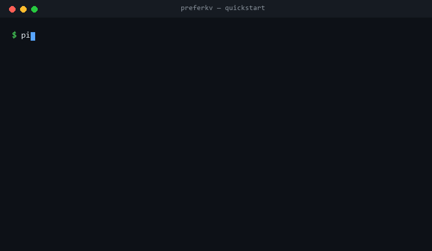
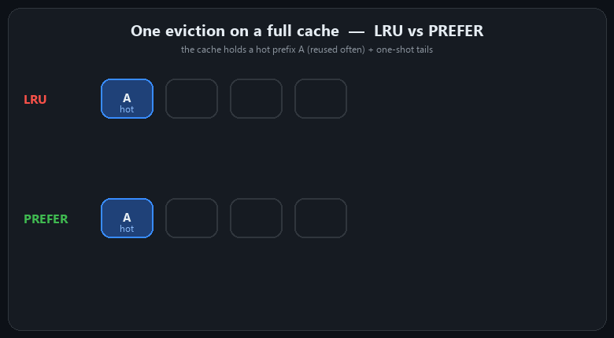
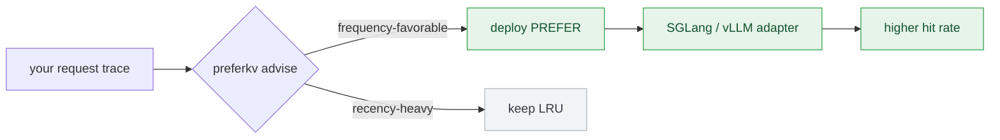
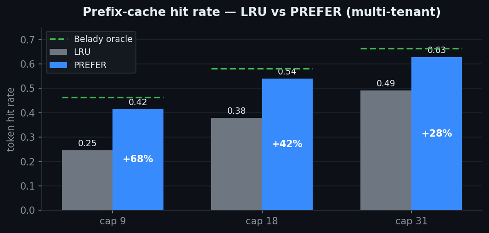

<div align="center">

# ⚡ preferkv

### Prefix-aware KV-cache eviction that beats LRU — with an advisor that tells you *when it actually will*.

[](#install)
[](LICENSE)
[](tests)
[](preferkv/py.typed)
[](pyproject.toml)
[](#-results)



<sub><a href="#-why">Why</a> · <a href="#-how-it-works">How it works</a> · <a href="#-quickstart">Quickstart</a> · <a href="#-results">Results</a> · <a href="#-engine-adapters">Adapters</a> · <a href="#-api">API</a></sub>

</div>

---

LLM serving engines (vLLM, SGLang) cache attention **KV blocks** in a prefix/radix tree
and evict by **Least Recently Used (LRU)**. LRU is far from optimal when popular content
returns after long gaps. **preferkv** evicts by *frequency + branchiness* instead of
recency — and counts that frequency **persistently across evictions**, the detail that
makes it actually work on a live engine.

> [!IMPORTANT]
> **Honest by design.** PREFER is *not* universally better — it wins on multi-tenant
> shared-template serving and agent session-resumption, and **loses** on tight,
> recency-heavy agent loops. The built-in **advisor** measures your workload and refuses
> to recommend PREFER where it would hurt.

## ✨ Highlights

<table>
<tr>
<td width="33%" valign="top">

**🎯 Up to 2× hit rate**
Beats LRU on frequency-favorable workloads; bounded against a Belady oracle.

</td>
<td width="33%" valign="top">

**🧭 Honest advisor**
`advise(trace)` simulates LRU vs PREFER and gives a go / no-go with the expected gain.

</td>
<td width="33%" valign="top">

**🔌 Drop-in adapters**
SGLang (validated live) and vLLM (experimental) — no fork, no rebuild.

</td>
</tr>
<tr>
<td valign="top">

**📦 Zero dependencies**
Pure standard-library core. `pip install` and go.

</td>
<td valign="top">

**🧪 Tested & typed**
21 tests, `py.typed`, CI on 3.9–3.12.

</td>
<td valign="top">

**⚙️ Engine-accurate**
Prefix-closed radix cache with lazy-heap eviction, matching real engines.

</td>
</tr>
</table>

## 🤔 Why

A hot prefix is reused *often* but not necessarily *recently*. Between its reuses, a
stream of unique **one-shot** content floods the cache. LRU evicts the hot prefix (it
looks "old"); PREFER keeps it because it is *frequent* — and remembers that frequency
even after the block was evicted once. A stock engine forgets it, which is why plain
frequency eviction barely helps until you make it **persistent**.

## 🧠 How it works

<div align="center">

</div>

```text
score(node) = log(1 + frequency) + 0.9 · log(1 + branchiness)      # recency breaks ties
```

Eviction removes the lowest-scoring cached leaf. **LRU and LFU are the axis-aligned
special cases** of the same family. The workflow:



## 📦 Install

```bash
pip install -e .          # from this repo — no dependencies, Python 3.8+
```

## 🚀 Quickstart

**1 — Use the cache** (blocks are any hashable: KV-block ids, token ids, prompt-chunk hashes):

```python
from preferkv import PrefixCache

cache = PrefixCache(capacity=2048, policy="prefer")   # or "lru" / "lfu"
hit_len = cache.access([12, 45, 9, 88])   # number of leading blocks served from cache

# ...or as a keyed application cache
cache.put(["sys-prompt", "few-shot", "q42"], value=expensive_state)
state = cache.get(["sys-prompt", "few-shot", "q42"])
```

**2 — Ask the advisor whether PREFER helps your workload** (the part with real impact):

```bash
preferkv demo                         # built-in demo, no data needed
preferkv advise your_trace.jsonl      # JSON Lines: one list of block-ids per request
```

```python
from preferkv import advise, load_trace

rec = advise(load_trace("your_trace.jsonl"))
if rec.recommend_prefer:
    deploy_prefer()                   # only where the simulation says it wins
```

On a recency-heavy trace the advisor prints **STICK WITH LRU** — so you never deploy
PREFER where it would hurt.

## 📊 Results

**In simulation** — multi-tenant workload, LRU vs PREFER vs the Belady-oracle ceiling:

<div align="center">

</div>

**Live on SGLang** — PREFER run *in-engine* (shipped adapter, verified loaded), Qwen3:

<div align="center">

| Qwen3 model | prefix-cache hit vs LRU | throughput |
|:--|:--:|:--:|
| Qwen3-0.6B | **+31%** | +4% |
| Qwen3-1.7B | **+31%** | +5% |
| Qwen3-4B | **+31%** | **+10%** |
| Qwen3-8B (FP8) | **+31%** | **+9%** |

</div>

The hit-rate gain is model-independent (the cache doesn't know the model); the
latency/throughput payoff **grows with model size** — bigger models make each recomputed
prefill more expensive. In pure simulation PREFER reaches up to **2×** the LRU hit rate
on frequency-favorable workloads.

## 🔌 Engine adapters

<table>
<tr><td width="50%" valign="top">

**SGLang** — *validated live*

```python
from preferkv.adapters.sglang import enable_prefer
enable_prefer()
# launch with:  --radix-eviction-policy lfu
```

The full gain also needs persistent frequency
(a small patch to the radix insert path;
see `preferkv/persist.py`).

</td><td width="50%" valign="top">

**vLLM** — *experimental*

```python
from preferkv.adapters.vllm import PreferEvictor
# in vLLM's block manager:
#   evictor = PreferEvictor()
```

Tested against the evictor interface;
not yet run on a live engine.

</td></tr>
</table>

## 🧩 API

<details>
<summary><b>Core API & module map</b></summary>

```python
from preferkv import (
    PrefixCache,          # prefix-closed radix cache, pluggable eviction
    LRU, LFU, Prefer,     # policies
    advise, load_trace,   # the advisor + trace loading
    simulate, simulate_belady, reuse_ceiling,   # simulator + references
    trace_stats, reuse_recency_corr,            # workload diagnostics
)
```

| module | purpose |
|:--|:--|
| `cache.py` | `PrefixCache` — prefix-closed radix cache, lazy-heap victim selection |
| `policies.py` | `LRU` · `LFU` · `Prefer` (frequency + branchiness) |
| `persist.py` | `PersistentFrequency` — counts keyed by a rolling hash, surviving eviction |
| `sim.py` | fast simulator + a prefix-aware **Belady oracle** |
| `advisor.py` | `advise(trace)` → go / no-go with expected gain |
| `trace.py` | JSONL loading, reuse-recency correlation, working-set |
| `adapters/` | `sglang`, `vllm` |
| `cli.py` | `preferkv advise · bench · demo` |

</details>

## ⚠️ Status

The **core** (cache, policies, persistent frequency, simulator, Belady oracle, advisor)
is unit-tested and stable. The **SGLang adapter is validated live** on Qwen3 0.6B–8B. The
**vLLM adapter is experimental**. Single-process, in-memory reference implementation.

## 🛠️ Development

```bash
pip install -e ".[dev]"
pytest -q
```

## 📄 Paper

The method is described in a paper currently under **double-anonymous review**. A
citation will be added on publication.

## License

[MIT](LICENSE).

<div align="center"><sub>Built for people who serve LLMs and care about cache hit rate.</sub></div>
