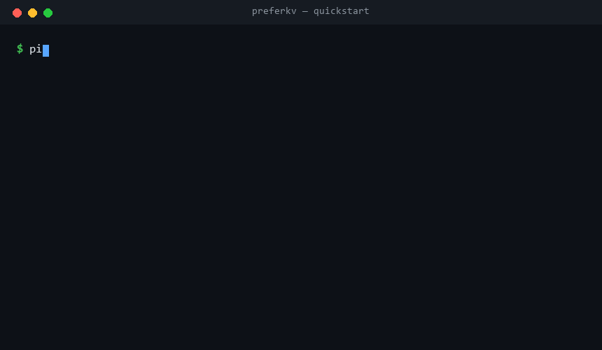
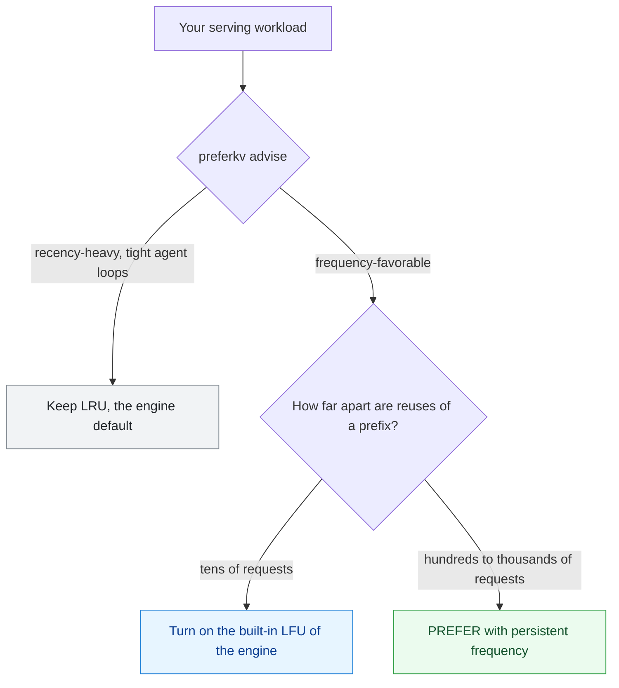
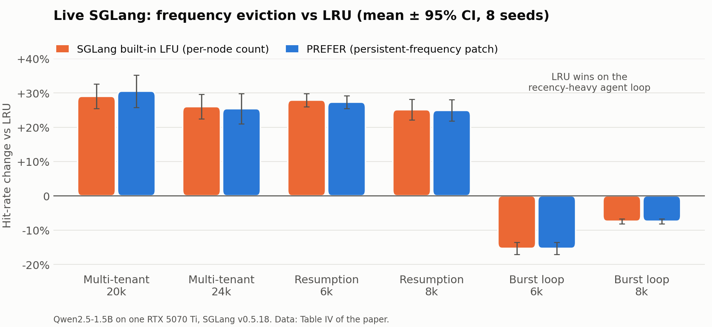
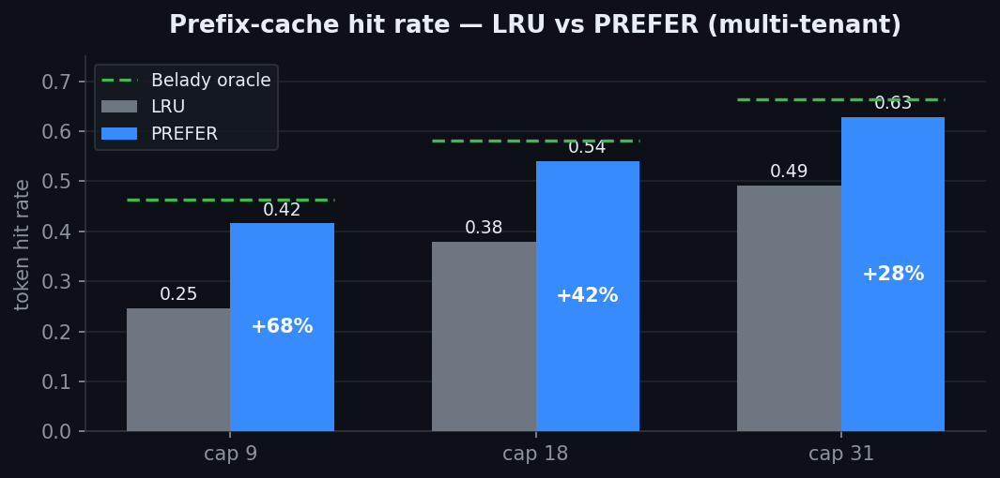

<div align="center">

# ⚡ preferkv

### Persistent-frequency KV-cache eviction for LLM prefix caching, with drop-in patches for SGLang and vLLM

**PREFER** keeps the prefixes your traffic actually reuses, remembers how often they were used even after they are evicted, and comes with an advisor that tells you **when it beats LRU and when it doesn't**.

<a href="paper/PREFER_iSAI-NLP2026.pdf"></a>
<a href="#-engine-integration"></a>
<a href="#-engine-integration"></a>

[](tests)
[](#-install)
[](LICENSE)
[](pyproject.toml)
[](preferkv/py.typed)



<sub><a href="#-tldr">TL;DR</a> · <a href="#-how-it-works">How it works</a> · <a href="#-which-policy-should-i-use">Which policy?</a> · <a href="#-install">Install</a> · <a href="#-quickstart">Quickstart</a> · <a href="#-engine-integration">SGLang / vLLM</a> · <a href="#-results">Results</a> · <a href="#-paper">Paper</a> · <a href="#-citation">Cite</a></sub>

</div>

---

> [!NOTE]
> 🎉 **Accepted at iSAI-NLP 2026** (IEEE, Nov 19–21, 2026).
> 📄 Paper: [**PREFER: Persistent-Frequency KV-Cache Eviction for LLM Prefix Caching**](paper/PREFER_iSAI-NLP2026.pdf)

## 🧭 TL;DR

vLLM and SGLang cache attention KV blocks for shared prompt prefixes and evict them **least-recently-used (LRU)** by default. On real LLM traffic that is often the wrong choice:

- 🔁 **Most blocks are one-shot.** About ¾ of the blocks in the production traces are never reused. LRU keeps each new one because it was just used, and pushes out a popular prefix to make room.
- 🧠 **Frequency fixes this, but only if it is remembered.** A count that resets on eviction (the LFU built into the engines) behaves almost like LRU when reuse is far apart. PREFER keeps counts **across evictions**, and that is the part that matters.
- 📈 **Results:**
  - In simulation, the searched frequency policy closes **14–27%** of the gap between LRU and a Belady reference, and reaches **1.9×** LRU's hit rate on conversation traffic.
  - Live, frequency eviction gains **+25–31%** hit rate on SGLang.
  - It also carries over to vLLM, and gives **up to +10.5% throughput** on an 8B model under load.
- 🚦 **It isn't always better.** On tight agent loops LRU wins (**−7% to −15%**). The built-in **advisor** simulates your workload and recommends PREFER only where it helps. It made the right call on **4 of 4** live workload families.

## 🧠 How it works

<div align="center">

</div>

```text
score(node) = log(1 + persistent_frequency) + 0.9 · log(1 + branchiness)     # recency breaks ties
evict       = the cached leaf with the lowest score
```

- **Persistent frequency** is how often a prefix was used, kept in a side table keyed by a rolling hash of the prefix tokens. Evicting the block does **not** reset its count, so a popular prefix that was dropped once is protected the next time it comes back.
- **Prefix-safe.** Every use of a block is also a use of its ancestors, so a parent's count is always at least its child's. The most frequent blocks therefore form a valid prefix tree, and evicting leaves alone can maintain it.
- **Cheap.** The library picks victims with a lazy min-heap, O(log n) per access. The engine patches add one rolling hash and one table update per inserted node. A bounded table costs 16 B per entry and loses ≤ 2.1% hit rate at 8× the cache size.

> [!TIP]
> In the paper's ablation, persistent frequency is what drives the gain. The other terms barely matter: changing the branchiness weight over [0, 3] moves the hit rate by ≤ 5.4%. Inside the engines, only childless leaves can be evicted, so branchiness is the same for every candidate there. **Live PREFER is persistent LFU with recency breaking ties.**

## 🚦 Which policy should I use?



For SGLang, the built-in LFU is `--radix-eviction-policy lfu`. PREFER needs the engine patch in [`patches/`](patches).

> [!IMPORTANT]
> **What the paper found.** On the constructed live workloads, prefixes come back within tens of requests. There, SGLang's built-in LFU (off by default) already gets **+25–29%**, and persistence adds no significant further gain. Persistence matters at **production-trace reuse distances** (90th percentile above 1,600 requests). That regime is shown in simulation, because a 16 GB GPU cannot hold production-scale working sets. Turning on the engine's existing LFU is a good first step; PREFER is the version that still works when reuses are far apart.

## 📦 Install

```bash
pip install git+https://github.com/E27-25/preferkv     # pure Python, no dependencies, Python 3.8+
```

or, from a clone, `pip install -e ".[dev]"`.

## 🚀 Quickstart

**1. Ask the advisor first** (needs no GPU). The input is a JSON Lines file with one list of block ids per request:

```bash
preferkv demo                         # built-in demo, no data needed
preferkv advise your_trace.jsonl      # → USE PREFER  /  STICK WITH LRU
```

```text
multi-tenant (frequency-favorable): corr=0.67  gain=+75.8%  -> USE PREFER
agent burst  (recency-favorable)  : corr=0.89  gain= -9.1%  -> STICK WITH LRU
```

**2. Use it from Python:**

```python
from preferkv import PrefixCache, advise, select_policy, load_trace

trace = load_trace("your_trace.jsonl")
print(advise(trace))                                   # go / no-go + expected gain

cache = PrefixCache(capacity=2048, policy=select_policy(trace))   # "prefer" or "lru"
hit_len = cache.access([12, 45, 9, 88])                # leading blocks served from cache

# ...or as a keyed application cache
cache.put(["sys-prompt", "few-shot", "q42"], value=expensive_state)
state = cache.get(["sys-prompt", "few-shot", "q42"])
```

**3. Compare against references** (simulator):

```python
from preferkv import simulate, simulate_belady, reuse_ceiling
simulate(trace, 2048, "lru"), simulate(trace, 2048, "prefer"), simulate_belady(trace, 2048)
```

## 🔌 Engine integration

<table>
<tr>
<th width="50%">🟠 SGLang <code>v0.5.18</code></th>
<th width="50%">🔵 vLLM <code>v0.24.0</code> (V1 engine)</th>
</tr>
<tr>
<td valign="top">

```bash
pip install "sglang==0.5.18" \
  git+https://github.com/E27-25/preferkv
cd <site-packages>
git apply -p2 patches/sglang-v0.5.18-prefer.patch

python -m sglang.launch_server \
  --model-path Qwen/Qwen2.5-1.5B-Instruct \
  --radix-eviction-policy lfu
```

What the patch changes:
- `radix_cache.py` gets a persistent prefix-to-count map.
- `LFUStrategy` scores nodes with PREFER.

Live: **+25–31%** hit rate over LRU (8 seeds). An earlier build gave +31% on Qwen3 0.6B–8B.

</td>
<td valign="top">

```bash
pip install "vllm==0.24.0" \
  git+https://github.com/E27-25/preferkv
cd <site-packages>
git apply -p1 patches/vllm-v0.24.0-block-pool-prefer.patch

vllm serve Qwen/Qwen2.5-0.5B-Instruct \
  --enable-prefix-caching
```

What the patch changes:
- `v1/core/block_pool.py` picks eviction victims by persistent frequency, with LRU order breaking ties.

Live: **+6.3%** hit rate over vLLM's LRU, at neutral latency.

</td>
</tr>
</table>

Step-by-step instructions are in [`patches/README.md`](patches/README.md). The Python adapters (`preferkv.adapters.sglang`, `preferkv.adapters.vllm`) expose the same scoring functions, so you can wire PREFER into other releases.

## 📊 Results

All numbers are from the [paper](paper/PREFER_iSAI-NLP2026.pdf).

### Live on SGLang: 8 seeds, 95% confidence intervals

<div align="center">
<picture>
  <source media="(prefers-color-scheme: dark)" srcset="assets/live_sglang_dark.png">
  
</picture>
</div>

<details>
<summary><b>Table view</b> (Table IV: SGLang v0.5.18, Qwen2.5-1.5B, concurrency 1)</summary>

| workload, KV budget | LRU hit | stock LFU | **PREFER** | PREFER mean TTFT ↓ | PREFER p99 TTFT ↓ | PREFER throughput |
|:--|:--:|:--:|:--:|:--:|:--:|:--:|
| multi-tenant 20k | .410 | +29.0 ± 3.6 | **+30.5 ± 4.7** | +16.6 ± 7.1 | +3.7 ± 5.1 | +7.2 ± 6.8 |
| multi-tenant 24k | .454 | **+26.0 ± 3.6** | +25.4 ± 4.4 | +12.8 ± 2.3 | +4.5 ± 2.6 | +2.6 ± 1.8 |
| resumption 6k | .367 | **+27.9 ± 1.9** | +27.3 ± 1.9 | −0.3 ± 1.3 | +2.5 ± 6.2 | +1.7 ± 1.6 |
| resumption 8k | .410 | **+25.1 ± 3.0** | +24.9 ± 3.1 | +1.1 ± 1.2 | +2.3 ± 4.3 | +1.5 ± 1.5 |
| burst loop 6k | .854 | −15.3 ± 1.8 | −15.3 ± 1.8 | −0.9 ± 2.9 | −3.3 ± 16.1 | +0.7 ± 1.3 |
| burst loop 8k | .877 | −7.4 ± 0.7 | −7.4 ± 0.7 | −1.4 ± 2.6 | −0.2 ± 9.1 | +0.5 ± 1.7 |

The table shows relative change vs LRU in %. Positive is better.

</details>

### Simulation on production traces (Mooncake, held-out data)

| trace / capacity | LRU | ARC | LIRS | LFU, in-cache | **LFU, persistent** | **PREFER** | Belady ref. |
|:--|:--:|:--:|:--:|:--:|:--:|:--:|:--:|
| conversation, 2k blocks | .052 | .055 | .062 | .055 | .099 | .095 | .236 |
| conversation, 4k blocks | .079 | .085 | .135 | .082 | .133 | .134 | .286 |
| tool/agent, 2k blocks | .365 | .367 | .376 | .367 | .395 | .393 | .498 |
| tool/agent, 4k blocks | .387 | .391 | .428 | .387 | .425 | .425 | .531 |

The table shows token hit rate. Counts that reset on eviction (in-cache LFU, ARC) stay close to LRU. Counts that **persist** (persistent LFU, PREFER) pull clearly ahead.

### Beyond one engine

| setting | result |
|:--|:--|
| 🔵 vLLM V1, flat block pool | **+6.3%** hit rate vs LRU, neutral latency |
| 🩺 Retrieval-augmented VLM app, skewed serving stream | **+14.5%** hit rate (simulator agrees within 0.5 points) |
| 🏋️ Qwen3-8B (FP8) under load, concurrency 1 → 32 | hit-rate gain stays at +9–10%; throughput gain grows from **+3.9% → +10.5%** |
| 🧭 Advisor vs live outcome | **4 / 4** correct decisions, including "keep LRU" on the burst loop |

<details>
<summary><b>Library simulator on a synthetic multi-tenant workload</b></summary>

<div align="center">

</div>

</details>

## 🧩 API

<details>
<summary><b>Core API and module map</b></summary>

```python
from preferkv import (
    PrefixCache,                                # prefix-closed radix cache, pluggable eviction
    LRU, LFU, Prefer, PersistentFrequency,      # policies + the persistent count table
    advise, select_policy, load_trace,          # advisor + auto selection + traces
    simulate, simulate_belady, reuse_ceiling,   # simulator + references
    trace_stats, reuse_recency_corr,            # workload diagnostics
)
```

| module | purpose |
|:--|:--|
| `cache.py` | `PrefixCache`: prefix-closed radix cache with lazy-heap victim selection |
| `policies.py` | `LRU` · `LFU` · `Prefer` |
| `persist.py` | `PersistentFrequency`: counts keyed by a rolling hash that survive eviction (optionally bounded: when full, all counts are halved) |
| `sim.py` | fast simulator, a prefix-aware Belady reference, and the infinite-cache ceiling |
| `advisor.py` | `advise` / `select_policy`: go / no-go based on simulating your trace |
| `trace.py` | JSONL loading, reuse-recency correlation, working set |
| `adapters/` | `sglang` (scoring for `LFUStrategy`), `vllm` (`PreferEvictor`) |
| `cli.py` | `preferkv advise · bench · demo` |
| `patches/` | engine patches for SGLang v0.5.18 and vLLM v0.24.0 |

</details>

## ⚠️ Limitations

These are the same limitations stated in the paper:

- **Reference, not optimum.** "Gap closed" is measured against a feasible Belady schedule, not a proven optimum.
- **Hardware.** All live runs used one consumer GPU (RTX 5070 Ti, 16 GB), mostly at concurrency 1. The live workloads are constructed, not replays of the production traces.
- **Where persistence helps.** At short reuse distances, persistent counts give no significant live gain over per-node counts. The large persistent-vs-in-cache gap is shown in simulation.
- **Single runs.** The load sweep, the cross-engine runs, and the application results are single runs per configuration.
- **Scope of the advisor.** It was validated on four workload families. Its predicted magnitudes overestimate live gains: trust its decisions, not its numbers.
- **LIRS.** LIRS matches PREFER at mid-range capacity, so the advantage over adaptive policies depends on the regime.

## 📄 Paper

<table>
<tr>
<td width="34%"><a href="paper/PREFER_iSAI-NLP2026.pdf"></a></td>
<td valign="top">

**PREFER: Persistent-Frequency KV-Cache Eviction for LLM Prefix Caching**

Watin Promfiy, Chaloemphon Sirikayon\*, Panwit Tuwanut, Suvit Poomrittigul
<br><sub>School of Information Technology, King Mongkut's Institute of Technology Ladkrabang, Bangkok, Thailand · \*corresponding author</sub>

*International Joint Symposium on Artificial Intelligence and Natural Language Processing* (**iSAI-NLP 2026**), IEEE.

📥 [**Download PDF**](paper/PREFER_iSAI-NLP2026.pdf) (6 pages)

<sub>© 2026 IEEE. Personal use of this material is permitted. Permission from IEEE must be obtained for all other uses, in any current or future media, including reprinting/republishing this material for advertising or promotional purposes, creating new collective works, for resale or redistribution to servers or lists, or reuse of any copyrighted component of this work in other works.</sub>

</td>
</tr>
</table>

## 📝 Citation

```bibtex
@inproceedings{promfiy2026prefer,
  title     = {{PREFER}: Persistent-Frequency {KV}-Cache Eviction for {LLM} Prefix Caching},
  author    = {Promfiy, Watin and Sirikayon, Chaloemphon and Tuwanut, Panwit and Poomrittigul, Suvit},
  booktitle = {Proceedings of the International Joint Symposium on Artificial Intelligence and Natural Language Processing (iSAI-NLP)},
  publisher = {IEEE},
  year      = {2026}
}
```

GitHub's **"Cite this repository"** button uses [`CITATION.cff`](CITATION.cff).

## 🛠️ Development

```bash
pip install -e ".[dev]"
pytest -q              # 23 tests
```

## 📜 License

The code is released under the [MIT](LICENSE) license. The files in [`patches/`](patches) modify Apache-2.0 sources of SGLang and vLLM. The paper PDF is © 2026 IEEE; see the notice above.

<div align="center"><sub>Built for people who serve LLMs and care about every cached token. ⚡</sub></div>
