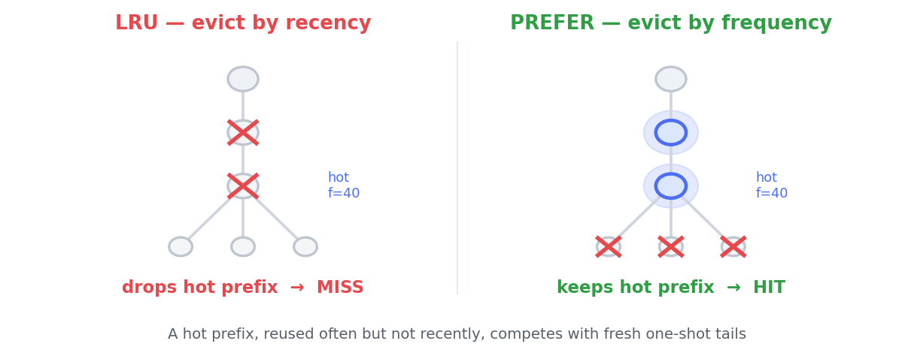

<div align="center">

# preferkv

**A prefix-aware cache with a better eviction policy than LRU — plus an advisor that tells you whether it will actually help *your* workload.**


-lightgrey)


</div>

---

LLM serving engines (vLLM, SGLang) cache attention **KV blocks** in a prefix/radix tree
and evict by **Least Recently Used (LRU)**. LRU is far from optimal when popular content
comes back after long gaps. `preferkv` provides **PREFER** — evict by *frequency +
branchiness* instead of recency, with the frequency counted **persistently across
evictions** (the detail that makes it work on a real engine).

> ### 🧭 Honest by design
> PREFER is **not** universally better. It wins on multi-tenant shared-template serving
> and agent session-resumption, and **loses** on tight, recency-heavy agent loops. The
> **advisor** measures your workload and refuses to recommend PREFER where it would hurt.

## How it works

A hot prefix is reused often but not necessarily *recently*. Between its reuses, a stream
of unique **one-shot** content floods the cache. LRU evicts the hot prefix (it looks
"old"); PREFER keeps it because it is *frequent* — and remembers that frequency even
after the block was evicted once (**persistent frequency**), which is exactly what a stock
engine forgets.

<div align="center">

</div>

```
score(node) = log(1 + frequency) + 0.9 · log(1 + branchiness)      # recency breaks ties
```

Eviction removes the lowest-scoring cached leaf. LRU and LFU are the axis-aligned special
cases of the same family.

## Install

```bash
pip install -e .          # from this repo (no dependencies; Python 3.8+)
```

## Quickstart

**1 — Use the cache** (any hashable blocks: KV-block ids, token ids, prompt-chunk hashes):

```python
from preferkv import PrefixCache

cache = PrefixCache(capacity=2048, policy="prefer")   # or "lru" / "lfu"
hit_len = cache.access([12, 45, 9, 88])   # number of leading blocks served from cache

# ...or as a keyed application cache
cache.put(["sys-prompt", "few-shot", "q42"], value=expensive_state)
state = cache.get(["sys-prompt", "few-shot", "q42"])
```

**2 — Ask the advisor whether PREFER helps your workload** (the part with real impact):

```bash
preferkv advise your_trace.jsonl      # JSON Lines: one list of block-ids per request
preferkv demo                         # built-in demo, no data needed
```

```python
from preferkv import advise, load_trace

rec = advise(load_trace("your_trace.jsonl"))
if rec.recommend_prefer:
    deploy_prefer()                   # only where the simulation says it wins
```

On a recency-heavy trace the advisor prints **STICK WITH LRU** instead — so you never
deploy PREFER where it would hurt.

## Results

The library's PREFER policy, run **in-engine on SGLang** (the shipped adapter, verified
loaded), on a multi-tenant workload at a fixed KV budget:

| Qwen3 model | prefix-cache hit rate vs LRU | throughput |
|:--|:--:|:--:|
| Qwen3-0.6B  | **+31%** | +4% |
| Qwen3-1.7B  | **+31%** | +5% |
| Qwen3-4B    | **+31%** | **+10%** |
| Qwen3-8B (FP8) | **+31%** | **+9%** |

The hit-rate gain is model-independent (the cache doesn't know the model); the
latency/throughput payoff **grows with model size** because bigger models make each
recomputed prefill more expensive. In pure simulation PREFER reaches up to **2×** the LRU
hit rate on frequency-favorable workloads and is bounded against a Belady oracle.

## Engine adapters

**SGLang** *(validated live)*:

```python
from preferkv.adapters.sglang import enable_prefer
enable_prefer()                       # patches SGLang's LFU strategy to PREFER scoring
# launch with:  --radix-eviction-policy lfu
```

The larger, robust gain also needs **persistent frequency** (a small change to the radix
cache's insert path so counts survive eviction — see `preferkv/persist.py`).

**vLLM** *(experimental)* — vLLM reclaims blocks through an `Evictor`:

```python
from preferkv.adapters.vllm import PreferEvictor
# in vLLM's block manager:  evictor = PreferEvictor()
```

## What's inside

| module | purpose |
|:--|:--|
| `cache.py` | `PrefixCache` — prefix-closed radix cache, pluggable eviction, lazy-heap victim selection |
| `policies.py` | `LRU` · `LFU` · `Prefer` (frequency + branchiness) |
| `persist.py` | `PersistentFrequency` — counts keyed by a rolling hash, surviving eviction |
| `sim.py` | fast simulator + a prefix-aware **Belady oracle** reference |
| `advisor.py` | `advise(trace)` → go / no-go with expected gain |
| `trace.py` | load JSONL traces, reuse-recency correlation, working-set |
| `adapters/` | `sglang`, `vllm` |
| `cli.py` | `preferkv advise · bench · demo` |

## Status

The **core** (cache, policies, persistent frequency, simulator, Belady oracle, advisor) is
unit-tested (21 tests) and stable. The **SGLang adapter is validated live** on Qwen3
0.6B–8B. The **vLLM adapter is experimental** (tested against the evictor interface, not
yet run on a live engine).

## Development

```bash
pip install -e ".[dev]"
pytest -q
```

## License

MIT — see [LICENSE](LICENSE).
