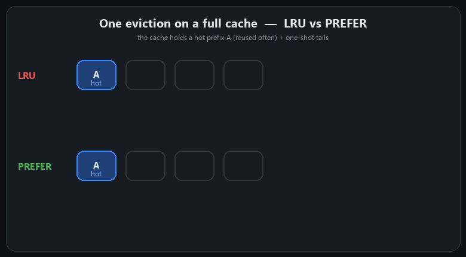
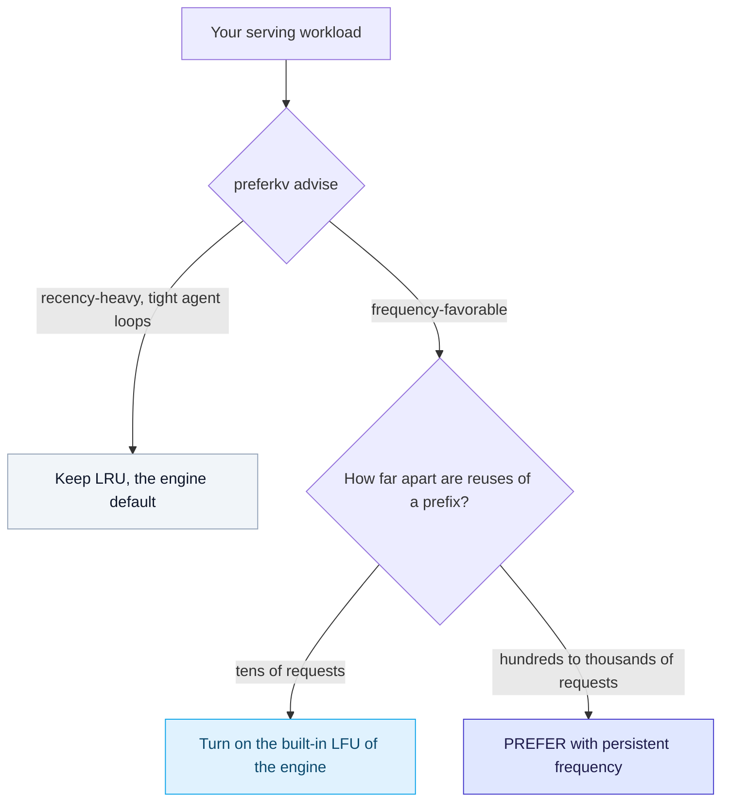
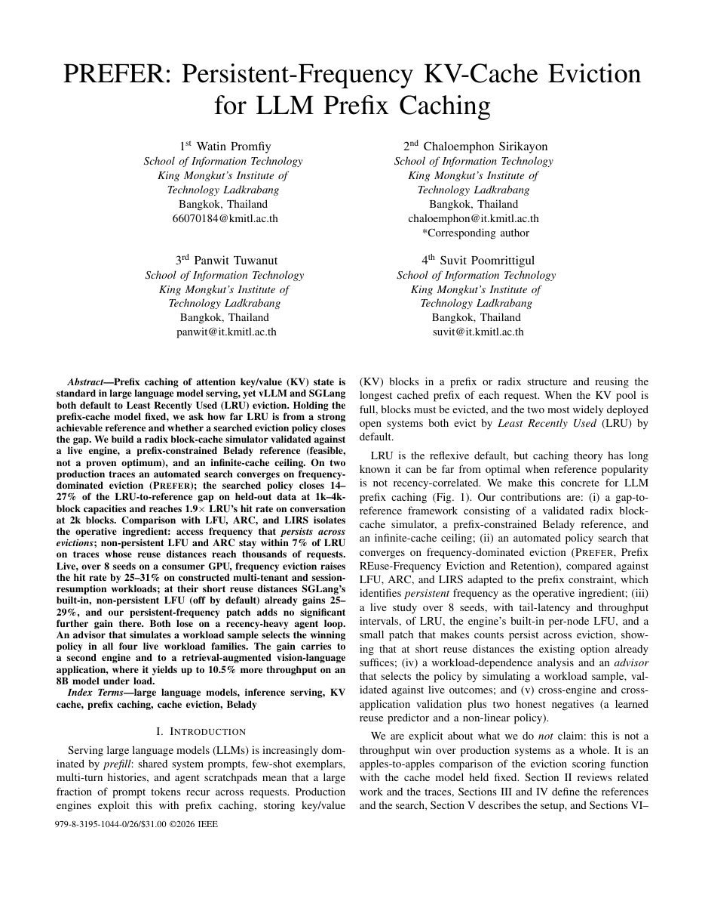

<p align="center">
  <picture>
    <source media="(prefers-color-scheme: dark)" srcset="assets/logo/preferkv-logo-dark.svg">
    
  </picture>
</p>

<h3 align="center">Persistent-frequency KV-cache eviction for LLM prefix caching</h3>

<p align="center">
| <a href="paper/PREFER_iSAI-NLP2026.pdf"><b>Paper</b></a>
| <a href="#getting-started"><b>Getting Started</b></a>
| <a href="patches/README.md"><b>SGLang &amp; vLLM Patches</b></a>
| <a href="#results"><b>Results</b></a>
| <a href="#citation"><b>Citation</b></a> |
</p>

<p align="center">
  <a href="paper/PREFER_iSAI-NLP2026.pdf"></a>
  <a href="patches/README.md"></a>
  <a href="patches/README.md"></a>
  <a href="#getting-started"></a>
  <a href="tests"></a>
  <a href="LICENSE"></a>
</p>

---

## Latest News

- [2026/11] The camera-ready paper and the SGLang / vLLM engine patches are now in this repository. PREFER will be presented at **iSAI-NLP 2026** (IEEE, Nov 19–21).
- [2026/10] **PREFER: Persistent-Frequency KV-Cache Eviction for LLM Prefix Caching** was accepted at iSAI-NLP 2026.
- [2026/07] v0.2.0: automatic policy selection (`select_policy`) and live validation on vLLM.
- [2026/07] Initial release of preferkv.

---

## About

LLM serving engines such as vLLM and SGLang reuse the attention KV cache of shared prompt prefixes. When memory runs out, both evict the **least recently used** (LRU) block by default. On real traffic that often throws away the wrong blocks: about three quarters of blocks are used only once, and LRU keeps each of them simply because it was just used, pushing out popular prefixes.

**preferkv** is a small library for frequency-based eviction of prefix caches, with patches that bring it into SGLang and vLLM.

- **Persistent frequency.** PREFER counts how often each prefix is used, and keeps that count after the block is evicted. The paper shows this is the part that matters: counts that reset on eviction, as in the built-in LFU of the engines or in ARC, stay close to LRU.
- **Engine patches.** Small, `git apply`-able patches for **SGLang v0.5.18** and **vLLM v0.24.0** (V1 engine).
- **Workload advisor.** `preferkv advise` simulates a sample of your traffic and recommends PREFER only where it beats LRU. It chose correctly on all four live workload families in the paper.
- **Simulator and references.** A prefix-closed radix cache simulator, a prefix-aware Belady reference, and an infinite-cache ceiling, for measuring how much hit rate a policy leaves on the table.
- **No dependencies.** The core is pure Python, typed, and covered by unit tests.

### Highlights from the paper

| | |
|:--|:--|
| Production traces (simulation) | The searched policy closes **14–27%** of the gap between LRU and a Belady reference, and reaches **1.9×** LRU's hit rate on conversation traffic |
| Live SGLang (8 seeds) | **+25–31%** hit rate over LRU on multi-tenant and session-resumption workloads |
| Live vLLM | **+6.3%** hit rate over LRU at the same memory budget, neutral latency |
| 8B model under load | up to **+10.5%** throughput (Qwen3-8B FP8, concurrency 32) |
| Where it loses | Tight agent loops: **−7% to −15%**. The advisor recommends keeping LRU there |

---

## How it works

<p align="center">
  
</p>

```text
score(node) = log(1 + persistent_frequency) + 0.9 · log(1 + branchiness)     # recency breaks ties
evict       = the cached leaf with the lowest score
```

- **Persistent frequency.** Use counts live in a side table keyed by a rolling hash of the prefix tokens. Evicting a block does not reset its count, so a popular prefix that was dropped once is protected when it returns.
- **Prefix-safe.** Every use of a block is also a use of its ancestors, so a parent's count is never below its child's. The most frequent blocks therefore form a valid prefix tree, and evicting leaves alone maintains it.
- **Low overhead.**
  - The library selects victims with a lazy min-heap, at O(log n) per access.
  - The engine patches add one rolling hash and one table update per inserted node.
  - A bounded table needs 16 bytes per entry, and costs at most 2.1% hit rate when sized at 8× the cache.

> [!NOTE]
> In the paper's ablation, persistent frequency is what drives the gain. Changing the branchiness weight over [0, 3] moves the hit rate by at most 5.4%. Inside the engines, only childless leaves can be evicted, so branchiness is the same for every candidate. On a live engine, PREFER is persistent LFU with recency breaking ties.

### When to use it



On the constructed live workloads, prefixes return within tens of requests. There, SGLang's built-in LFU (`--radix-eviction-policy lfu`, off by default) already gains **+25–29%**, and persistent counts add no significant improvement.

Persistent counts matter at production-trace reuse distances, where the 90th percentile is above 1,600 requests. That regime is shown in simulation, because a 16 GB GPU cannot hold production-scale working sets.

---

## Getting Started

Install from GitHub (Python 3.8+, no dependencies):

```bash
pip install git+https://github.com/E27-25/preferkv
```

**Check your workload first.** The input is a JSON Lines file with one list of block ids per request:

```bash
preferkv demo                       # built-in example, no data needed
preferkv advise your_trace.jsonl    # prints USE PREFER or STICK WITH LRU
```

```text
multi-tenant (frequency-favorable): corr=0.67  gain=+75.8%  -> USE PREFER
agent burst  (recency-favorable)  : corr=0.89  gain= -9.1%  -> STICK WITH LRU
```

**Use it from Python:**

```python
from preferkv import PrefixCache, advise, select_policy, load_trace

trace = load_trace("your_trace.jsonl")
print(advise(trace))                                    # recommendation and expected gain

cache = PrefixCache(capacity=2048, policy=select_policy(trace))   # "prefer" or "lru"
hit_len = cache.access([12, 45, 9, 88])                 # leading blocks served from cache

# keyed application cache
cache.put(["sys-prompt", "few-shot", "q42"], value=expensive_state)
state = cache.get(["sys-prompt", "few-shot", "q42"])
```

**Compare against the references:**

```python
from preferkv import simulate, simulate_belady, reuse_ceiling

simulate(trace, 2048, "lru"), simulate(trace, 2048, "prefer"), simulate_belady(trace, 2048)
```

---

## Engine Integration

| Engine | Version | Patch | Live result |
|:--|:--|:--|:--|
| **SGLang** | v0.5.18 | [`sglang-v0.5.18-prefer.patch`](patches/sglang-v0.5.18-prefer.patch) | +25–31% hit rate over LRU (8 seeds) |
| **vLLM** | v0.24.0 (V1) | [`vllm-v0.24.0-block-pool-prefer.patch`](patches/vllm-v0.24.0-block-pool-prefer.patch) | +6.3% hit rate over LRU |

<details open>
<summary><b>SGLang</b></summary>

```bash
pip install "sglang==0.5.18" git+https://github.com/E27-25/preferkv
cd "$(python -c 'import sglang, os; print(os.path.dirname(os.path.dirname(sglang.__file__)))')"
git apply -p2 /path/to/preferkv/patches/sglang-v0.5.18-prefer.patch

python -m sglang.launch_server --model-path Qwen/Qwen2.5-1.5B-Instruct \
    --radix-eviction-policy lfu
```

What the patch changes:
- `radix_cache.py` gets a persistent prefix-to-count map.
- `LFUStrategy` scores nodes with PREFER.

</details>

<details>
<summary><b>vLLM</b></summary>

```bash
pip install "vllm==0.24.0" git+https://github.com/E27-25/preferkv
cd "$(python -c 'import vllm, os; print(os.path.dirname(os.path.dirname(vllm.__file__)))')"
git apply -p1 /path/to/preferkv/patches/vllm-v0.24.0-block-pool-prefer.patch

vllm serve Qwen/Qwen2.5-0.5B-Instruct --enable-prefix-caching
```

What the patch changes: when prefix caching is on, `v1/core/block_pool.py` chooses eviction victims by persistent frequency, with LRU order breaking ties.

</details>

More detail is in [`patches/README.md`](patches/README.md). The Python adapters (`preferkv.adapters.sglang`, `preferkv.adapters.vllm`) expose the same scoring functions, so you can port PREFER to other releases.

---

## Results

All numbers below are from the [paper](paper/PREFER_iSAI-NLP2026.pdf).

### Live on SGLang

<p align="center">
  <picture>
    <source media="(prefers-color-scheme: dark)" srcset="assets/live_sglang_dark.png">
    
  </picture>
</p>

<details>
<summary>Table view (Table IV: SGLang v0.5.18, Qwen2.5-1.5B, concurrency 1, mean ± 95% CI over 8 seeds)</summary>

| workload, KV budget | LRU hit | stock LFU | PREFER | PREFER mean TTFT ↓ | PREFER p99 TTFT ↓ | PREFER throughput |
|:--|:--:|:--:|:--:|:--:|:--:|:--:|
| multi-tenant 20k | .410 | +29.0 ± 3.6 | **+30.5 ± 4.7** | +16.6 ± 7.1 | +3.7 ± 5.1 | +7.2 ± 6.8 |
| multi-tenant 24k | .454 | **+26.0 ± 3.6** | +25.4 ± 4.4 | +12.8 ± 2.3 | +4.5 ± 2.6 | +2.6 ± 1.8 |
| resumption 6k | .367 | **+27.9 ± 1.9** | +27.3 ± 1.9 | −0.3 ± 1.3 | +2.5 ± 6.2 | +1.7 ± 1.6 |
| resumption 8k | .410 | **+25.1 ± 3.0** | +24.9 ± 3.1 | +1.1 ± 1.2 | +2.3 ± 4.3 | +1.5 ± 1.5 |
| burst loop 6k | .854 | −15.3 ± 1.8 | −15.3 ± 1.8 | −0.9 ± 2.9 | −3.3 ± 16.1 | +0.7 ± 1.3 |
| burst loop 8k | .877 | −7.4 ± 0.7 | −7.4 ± 0.7 | −1.4 ± 2.6 | −0.2 ± 9.1 | +0.5 ± 1.7 |

Values are relative change vs LRU in %. Positive is better.

</details>

### Simulation on production traces

Token hit rate on held-out data from the public Mooncake traces:

| trace / capacity | LRU | ARC | LIRS | LFU, in-cache | LFU, persistent | PREFER | Belady ref. |
|:--|:--:|:--:|:--:|:--:|:--:|:--:|:--:|
| conversation, 2k blocks | .052 | .055 | .062 | .055 | .099 | .095 | .236 |
| conversation, 4k blocks | .079 | .085 | .135 | .082 | .133 | .134 | .286 |
| tool/agent, 2k blocks | .365 | .367 | .376 | .367 | .395 | .393 | .498 |
| tool/agent, 4k blocks | .387 | .391 | .428 | .387 | .425 | .425 | .531 |

Policies whose counts reset on eviction (in-cache LFU, ARC) stay close to LRU. Policies with persistent counts (persistent LFU, PREFER) pull clearly ahead.

### Other engines and applications

| setting | result |
|:--|:--|
| vLLM V1, flat block pool | +6.3% hit rate vs LRU, neutral latency |
| Retrieval-augmented vision-language application, skewed serving stream | +14.5% hit rate; the simulator agrees within 0.5 points |
| Qwen3-8B (FP8) under load, concurrency 1 to 32 | Hit-rate gain stays at +9–10%; throughput gain grows from +3.9% to +10.5% |
| Advisor vs live outcome | 4 of 4 correct decisions, including "keep LRU" on the burst loop |

### Limitations

These are the limitations stated in the paper:

- **Reference, not optimum.** "Gap closed" is measured against a feasible Belady schedule, not a proven optimum.
- **Hardware.** Live runs used one 16 GB consumer GPU, mostly at concurrency 1.
- **Workloads.** The live workloads are constructed, not replays of the production traces.
- **Single runs.** The load sweep, the cross-engine runs, and the application results are single runs per configuration.
- **Advisor.** Its decisions were validated on four workload families. Its predicted magnitudes overestimate live gains.
- **LIRS** matches PREFER at mid-range capacity.

---

## Project Structure

```text
preferkv/
├── preferkv/
│   ├── cache.py        PrefixCache: prefix-closed radix cache, lazy-heap victim selection
│   ├── policies.py     LRU, LFU, Prefer
│   ├── persist.py      PersistentFrequency: counts that survive eviction (bounded, with decay)
│   ├── sim.py          simulator, prefix-aware Belady reference, infinite-cache ceiling
│   ├── advisor.py      advise / select_policy
│   ├── trace.py        JSONL traces and workload statistics
│   ├── cli.py          preferkv advise | bench | demo
│   └── adapters/       sglang.py, vllm.py
├── patches/            engine patches for SGLang v0.5.18 and vLLM v0.24.0
├── paper/              camera-ready paper (iSAI-NLP 2026)
├── examples/           quickstart.py
└── tests/
```

---

## Contributing

Issues and pull requests are welcome. Ports of the engine patches to newer SGLang or vLLM releases are especially useful. See [CONTRIBUTING.md](CONTRIBUTING.md) to get set up.

```bash
pip install -e ".[dev]"
pytest -q
```

---

## Citation

If you use preferkv or PREFER in your research, please cite:

```bibtex
@inproceedings{promfiy2026prefer,
  title     = {{PREFER}: Persistent-Frequency {KV}-Cache Eviction for {LLM} Prefix Caching},
  author    = {Promfiy, Watin and Sirikayon, Chaloemphon and Tuwanut, Panwit and Poomrittigul, Suvit},
  booktitle = {Proceedings of the International Joint Symposium on Artificial Intelligence and Natural Language Processing (iSAI-NLP)},
  publisher = {IEEE},
  year      = {2026}
}
```

<table>
<tr>
<td width="30%"><a href="paper/PREFER_iSAI-NLP2026.pdf"></a></td>
<td valign="top">

**PREFER: Persistent-Frequency KV-Cache Eviction for LLM Prefix Caching**<br>
Watin Promfiy, Chaloemphon Sirikayon\*, Panwit Tuwanut, Suvit Poomrittigul<br>
<sub>School of Information Technology, King Mongkut's Institute of Technology Ladkrabang, Bangkok, Thailand · \*corresponding author</sub>

*International Joint Symposium on Artificial Intelligence and Natural Language Processing* (iSAI-NLP 2026), IEEE.

[Download PDF](paper/PREFER_iSAI-NLP2026.pdf) · 6 pages

<sub>© 2026 IEEE. Personal use of this material is permitted. Permission from IEEE must be obtained for all other uses, in any current or future media, including reprinting/republishing this material for advertising or promotional purposes, creating new collective works, for resale or redistribution to servers or lists, or reuse of any copyrighted component of this work in other works.</sub>

</td>
</tr>
</table>

---

## License

preferkv is released under the [MIT License](LICENSE). The files in [`patches/`](patches) modify Apache-2.0 sources of SGLang and vLLM. The paper PDF is © 2026 IEEE.
