<p align="center">
  
</p>

<p align="center">
| <a href="paper/PREFER_iSAI-NLP2026.pdf"><b>Paper</b></a>
| <a href="docs/RESULTS.md"><b>Results</b></a>
| <a href="patches/README.md"><b>SGLang &amp; vLLM</b></a>
| <a href="#citation"><b>Citation</b></a> |
</p>

<p align="center">
  <a href="paper/PREFER_iSAI-NLP2026.pdf"></a>
  <a href="https://www.python.org"></a>
  <a href="LICENSE"></a>
</p>

---

**Latest News**

- [2026/11] Paper and engine patches released. PREFER will be presented at iSAI-NLP 2026 (IEEE, Nov 19–21).
- [2026/10] PREFER was accepted at iSAI-NLP 2026.

---

## About

vLLM and SGLang cache the KV state of shared prompt prefixes, and evict the least recently used (LRU) block when memory runs out. On real traffic most blocks are used only once, so LRU often evicts a popular prefix just to keep a block nobody will ask for again.

**PREFER** evicts by how often a prefix is used instead. It keeps those counts even after the block is evicted, which is the detail that makes the difference.

<p align="center">
  <picture>
    <source media="(prefers-color-scheme: dark)" srcset="assets/features_dark.webp">
    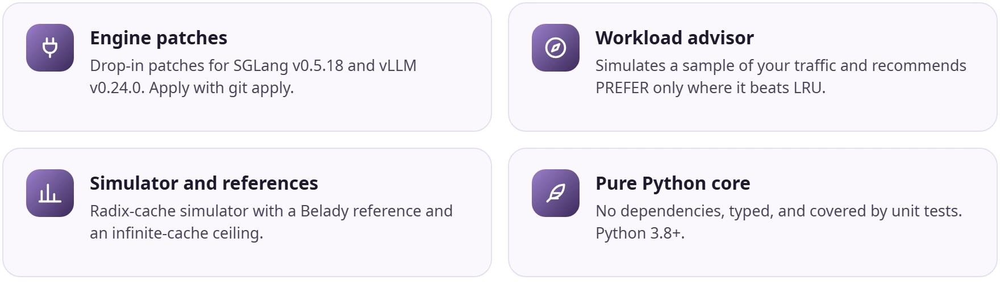
  </picture>
</p>

<p align="center">
  <picture>
    <source media="(prefers-color-scheme: dark)" srcset="assets/hero_dark.png">
    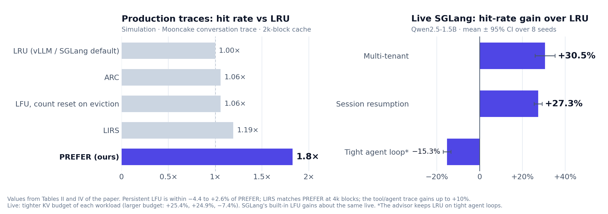
  </picture>
</p>

<p align="center">
  
</p>

It also gains **+6.3%** hit rate on vLLM. See the [full results](docs/RESULTS.md), including where PREFER does not help.

<p align="center">
  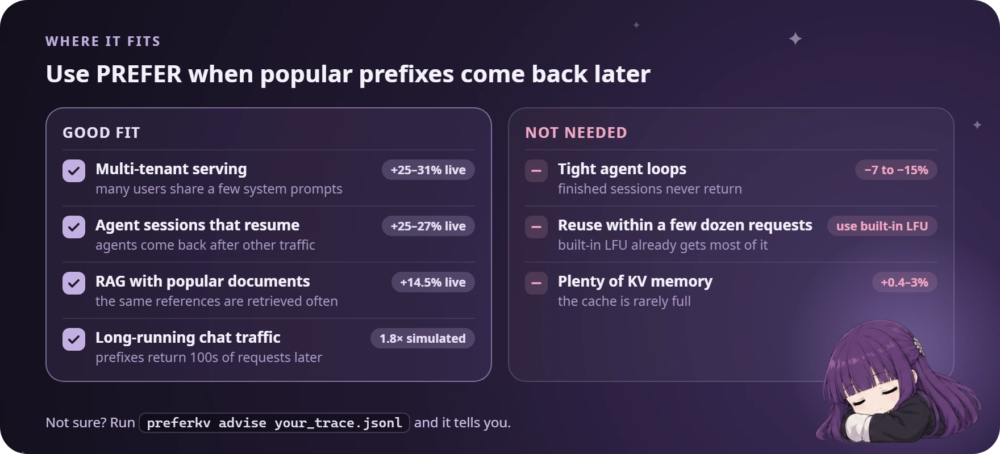
</p>

## How it works

<p align="center">
  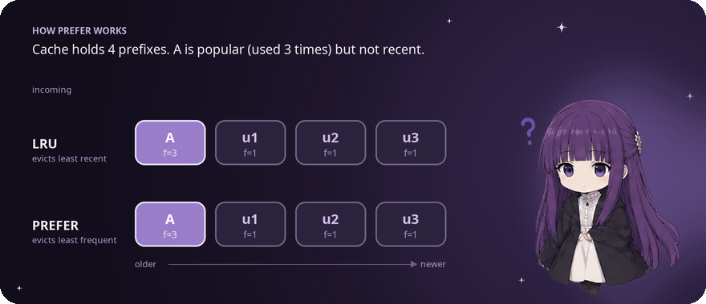
</p>

<p align="center">
  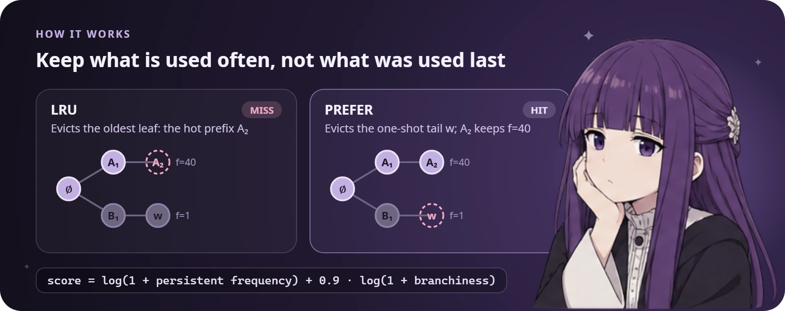
</p>

<sub>Animation also available as [MP4](assets/anim/how-prefer-works.mp4). More detail in [docs/RESULTS.md](docs/RESULTS.md).</sub>

## Getting Started

<p align="center">
  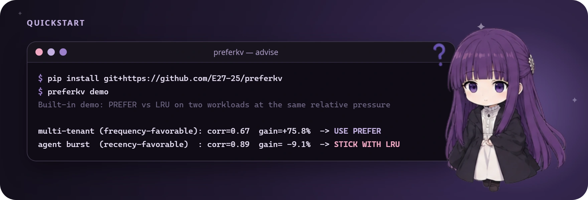
</p>

```bash
pip install git+https://github.com/E27-25/preferkv
```

Check whether PREFER helps your workload. The trace is JSON Lines, one list of block ids per request:

```bash
preferkv advise your_trace.jsonl     # USE PREFER  or  STICK WITH LRU
```

Use it in Python:

```python
from preferkv import PrefixCache, select_policy, load_trace

trace = load_trace("your_trace.jsonl")
cache = PrefixCache(capacity=2048, policy=select_policy(trace))
hit_len = cache.access([12, 45, 9, 88])      # leading blocks served from cache
```

## SGLang and vLLM

| Engine | Patch | Live gain vs LRU |
|:--|:--|:--|
| SGLang v0.5.18 | [`sglang-v0.5.18-prefer.patch`](patches/sglang-v0.5.18-prefer.patch) | +25–31% hit rate |
| vLLM v0.24.0 | [`vllm-v0.24.0-block-pool-prefer.patch`](patches/vllm-v0.24.0-block-pool-prefer.patch) | +6.3% hit rate |

Apply the patch inside `site-packages`, then start the server as usual. For SGLang, add `--radix-eviction-policy lfu`. Step-by-step instructions are in [`patches/README.md`](patches/README.md).

## Contributing

Issues and pull requests are welcome, especially ports of the patches to newer engine releases. See [CONTRIBUTING.md](CONTRIBUTING.md).

## Paper

<p align="center">
  <a href="paper/PREFER_iSAI-NLP2026.pdf"></a>
</p>

<details>
<summary><b>Preview all 6 pages</b></summary>
<br>
<p align="center">
  <a href="paper/PREFER_iSAI-NLP2026.pdf"></a>
  <a href="paper/PREFER_iSAI-NLP2026.pdf">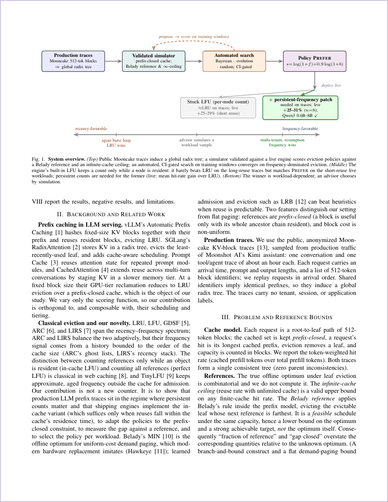</a>
  <a href="paper/PREFER_iSAI-NLP2026.pdf">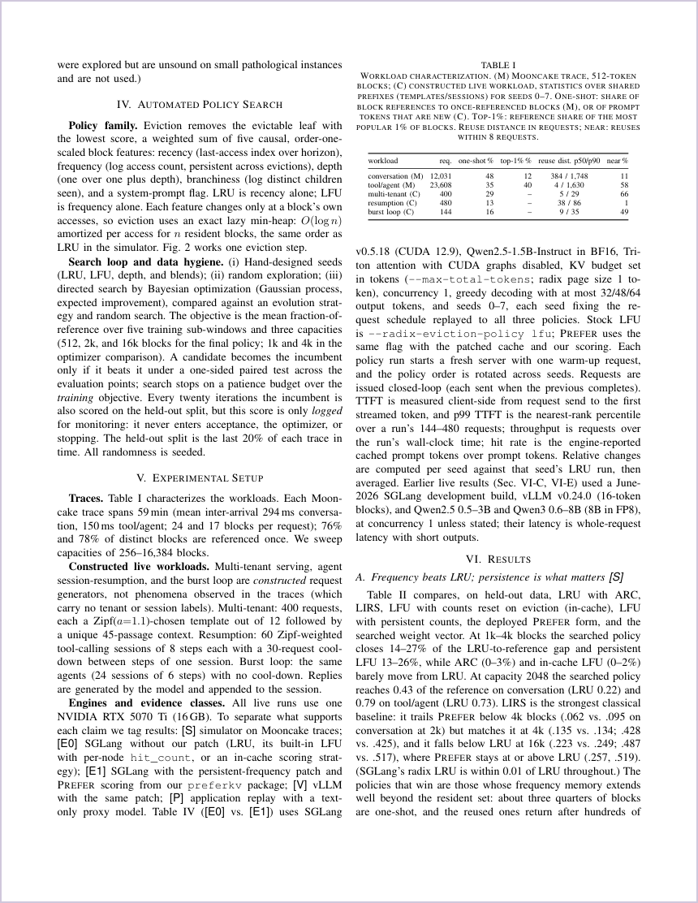</a>
  <a href="paper/PREFER_iSAI-NLP2026.pdf">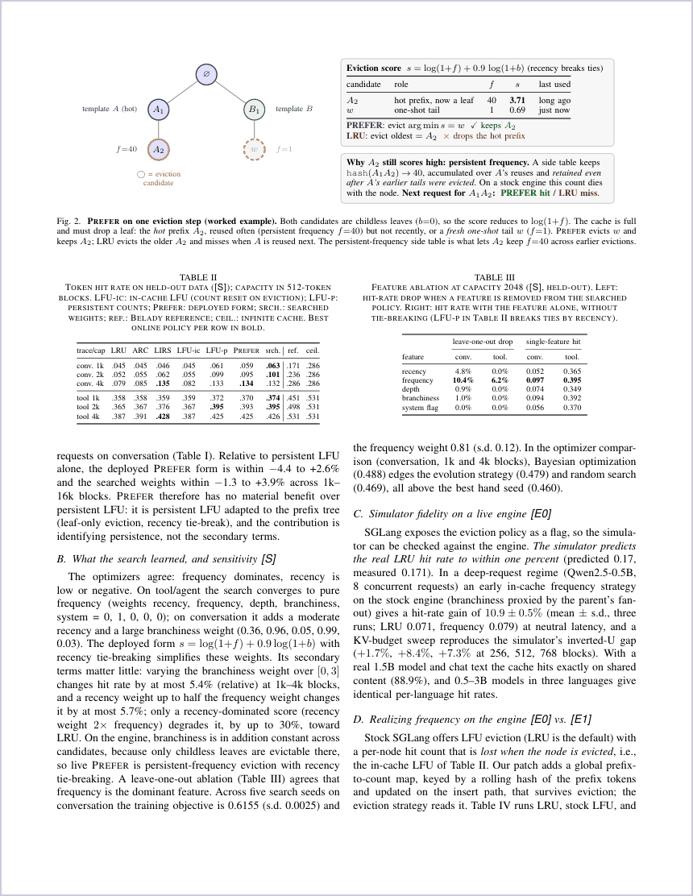</a>
  <a href="paper/PREFER_iSAI-NLP2026.pdf">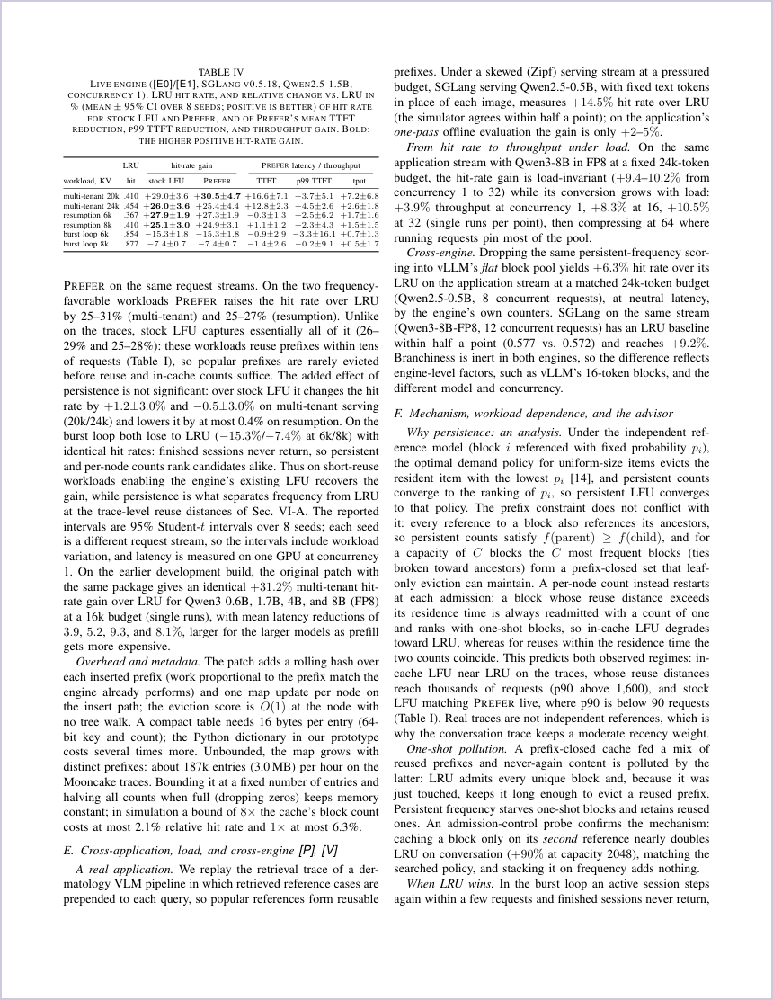</a>
  <a href="paper/PREFER_iSAI-NLP2026.pdf">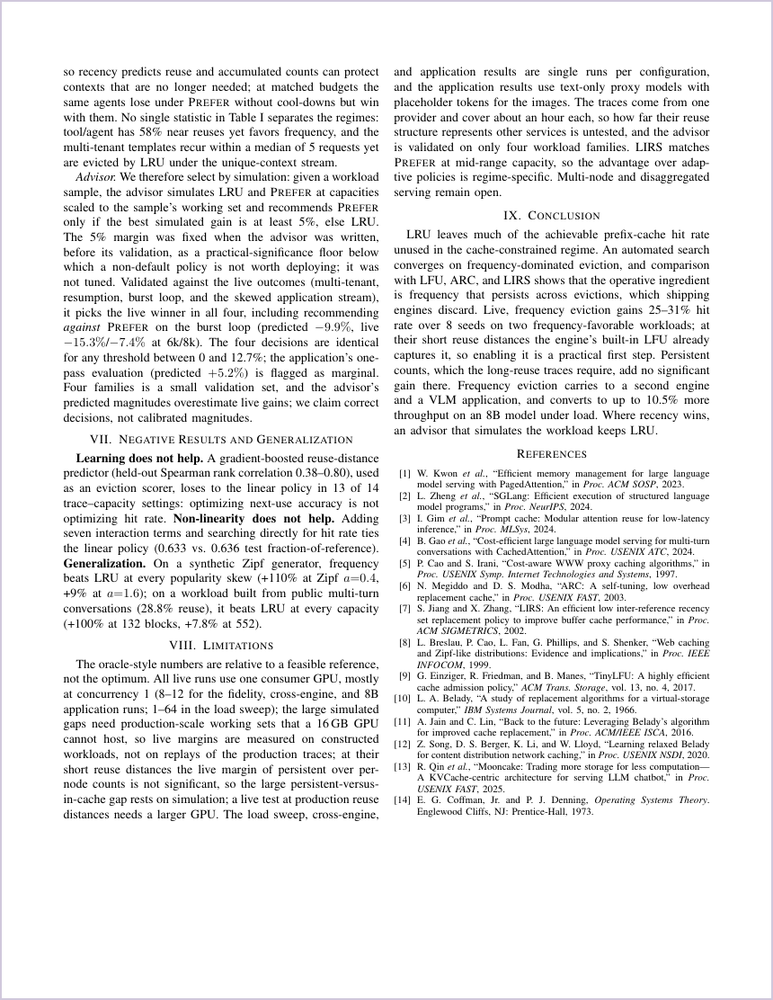</a>
</p>
</details>

## Citation

If you use preferkv or PREFER in your research, please cite:

```bibtex
@inproceedings{promfiy2026prefer,
  title     = {{PREFER}: Persistent-Frequency {KV}-Cache Eviction for {LLM} Prefix Caching},
  author    = {Promfiy, Watin and Sirikayon, Chaloemphon and Tuwanut, Panwit and Poomrittigul, Suvit},
  booktitle = {Proceedings of the International Joint Symposium on Artificial Intelligence and Natural Language Processing (iSAI-NLP)},
  publisher = {IEEE},
  year      = {2026}
}
```

## License

The code is released under the [MIT License](LICENSE). The files in `patches/` modify Apache-2.0 sources of SGLang and vLLM. The [paper](paper/PREFER_iSAI-NLP2026.pdf) is © 2026 IEEE: personal use is permitted, and any other use requires permission from IEEE.

The mascot images in `assets/mascot/` and the images that include them (the banner, the panels in `assets/panels/`, the paper panel, the animation in `assets/anim/`, and the social preview card) contain fan art of Fern from *Frieren: Beyond Journey's End* (© Kanehito Yamada, Tsukasa Abe / Shogakukan). They are not covered by the MIT License, and this project is not affiliated with or endorsed by the rights holders.

<p align="center">
  <br>
  <sub>Thanks for reading.</sub>
</p>
