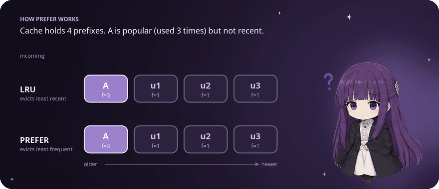
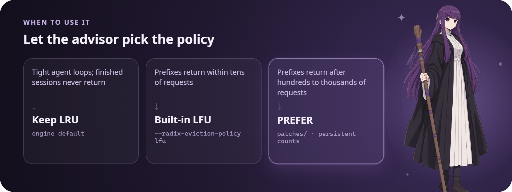
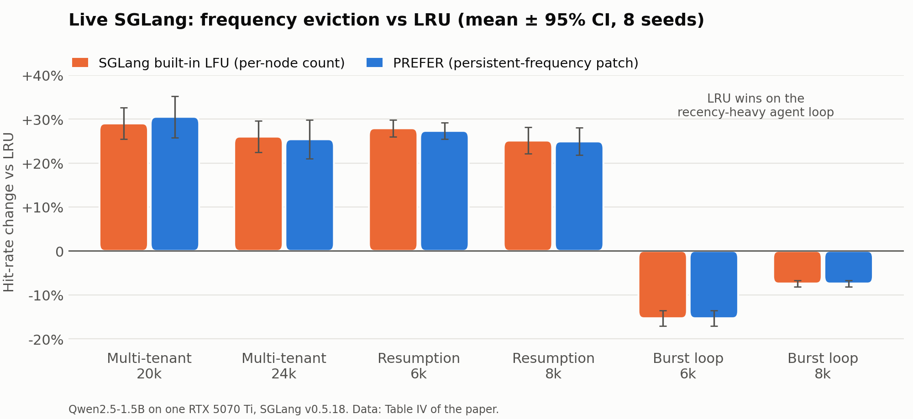

# How PREFER works, and full results

All numbers on this page are from the [paper](../paper/PREFER_iSAI-NLP2026.pdf).

## How it works

<p align="center">
  
</p>

```text
score(node) = log(1 + persistent_frequency) + 0.9 · log(1 + branchiness)     # recency breaks ties
evict       = the cached leaf with the lowest score
```

- **Persistent frequency.** Use counts are stored in a side table keyed by a rolling hash of the prefix tokens. Evicting a block does not reset its count, so a popular prefix that was dropped once is protected when it comes back.
- **Prefix-safe.** Every use of a block is also a use of its ancestors, so a parent's count is never below its child's. The most frequent blocks therefore form a valid prefix tree, which leaf-only eviction can maintain.
- **Low overhead.** The library picks victims with a lazy min-heap (O(log n) per access). A bounded count table needs 16 bytes per entry and costs at most 2.1% hit rate when sized at 8× the cache.

In the paper's ablation, persistent frequency drives the gain; varying the branchiness weight over [0, 3] changes the hit rate by at most 5.4%. Inside the engines only childless leaves can be evicted, so branchiness is the same for every candidate there. On a live engine, PREFER is persistent LFU with recency tie-breaking.

## When to use it

<p align="center">
  
</p>

When prefixes return within tens of requests, as in the constructed live workloads, SGLang's built-in LFU (`--radix-eviction-policy lfu`) already gains +25–29%, and persistent counts add no significant improvement.

Persistent counts matter at production-trace reuse distances, where the 90th percentile is above 1,600 requests. That regime is shown in simulation.

## Live on SGLang

<p align="center">
  <picture>
    <source media="(prefers-color-scheme: dark)" srcset="../assets/live_sglang_dark.png">
    
  </picture>
</p>

SGLang v0.5.18, Qwen2.5-1.5B, concurrency 1. Each value is the mean ± 95% CI over 8 seeds, given as % change vs LRU (positive is better).

| workload, KV budget | LRU hit | stock LFU | PREFER | PREFER mean TTFT ↓ | PREFER p99 TTFT ↓ | PREFER throughput |
|:--|:--:|:--:|:--:|:--:|:--:|:--:|
| multi-tenant 20k | .410 | +29.0 ± 3.6 | **+30.5 ± 4.7** | +16.6 ± 7.1 | +3.7 ± 5.1 | +7.2 ± 6.8 |
| multi-tenant 24k | .454 | **+26.0 ± 3.6** | +25.4 ± 4.4 | +12.8 ± 2.3 | +4.5 ± 2.6 | +2.6 ± 1.8 |
| resumption 6k | .367 | **+27.9 ± 1.9** | +27.3 ± 1.9 | −0.3 ± 1.3 | +2.5 ± 6.2 | +1.7 ± 1.6 |
| resumption 8k | .410 | **+25.1 ± 3.0** | +24.9 ± 3.1 | +1.1 ± 1.2 | +2.3 ± 4.3 | +1.5 ± 1.5 |
| burst loop 6k | .854 | −15.3 ± 1.8 | −15.3 ± 1.8 | −0.9 ± 2.9 | −3.3 ± 16.1 | +0.7 ± 1.3 |
| burst loop 8k | .877 | −7.4 ± 0.7 | −7.4 ± 0.7 | −1.4 ± 2.6 | −0.2 ± 9.1 | +0.5 ± 1.7 |

## Simulation on production traces

Token hit rate on held-out data from the public Mooncake traces:

| trace / capacity | LRU | ARC | LIRS | LFU, in-cache | LFU, persistent | PREFER | Belady ref. |
|:--|:--:|:--:|:--:|:--:|:--:|:--:|:--:|
| conversation, 2k blocks | .052 | .055 | .062 | .055 | .099 | .095 | .236 |
| conversation, 4k blocks | .079 | .085 | .135 | .082 | .133 | .134 | .286 |
| tool/agent, 2k blocks | .365 | .367 | .376 | .367 | .395 | .393 | .498 |
| tool/agent, 4k blocks | .387 | .391 | .428 | .387 | .425 | .425 | .531 |

Counts that reset on eviction (in-cache LFU, ARC) stay close to LRU; persistent counts (persistent LFU, PREFER) pull clearly ahead.

## Other engines and applications

| setting | result |
|:--|:--|
| vLLM V1, flat block pool | +6.3% hit rate vs LRU, neutral latency |
| Retrieval-augmented vision-language application, skewed stream | +14.5% hit rate (simulator within 0.5 points) |
| Qwen3-8B (FP8) under load, concurrency 1 → 32 | hit-rate gain stays at +9–10%; throughput gain grows from +3.9% to +10.5% |
| Advisor vs live outcome | 4 of 4 correct decisions, including "keep LRU" on the burst loop |

## Limitations


- "Gap closed" is measured against a feasible Belady schedule, not a proven optimum.
- Live runs used one 16 GB consumer GPU, mostly at concurrency 1, on constructed workloads rather than replays of the production traces.
- The load sweep, cross-engine, and application results are single runs per configuration.
- The advisor was validated on four workload families, and its predicted magnitudes overestimate live gains.
- LIRS matches PREFER at mid-range capacity.
